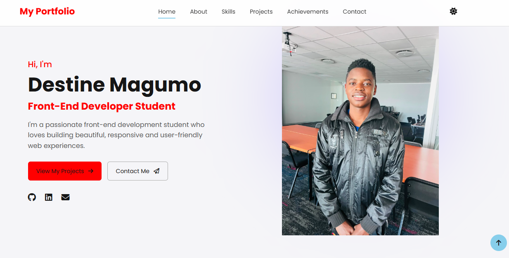

# OIBSIP - Web Development & Designing - Task 2: Personal Portfolio

Submitted for the AICTE Oasis Infobyte Student Internship Program (SIP), Web Development & Designing, Level 1.

- **Intern:** Destine Magumo
- **Task:** Task 2 - Personal Portfolio
- **Live demo:** https://destineportfolio.vercel.app/
- **Demo video and LinkedIn post:** https://lnkd.in/p/dmyA2Xwz

## Objective

Build a personal portfolio website that introduces me, shows my skills and projects, and gives visitors a way to contact me, using HTML5, CSS3 and JavaScript.

## Steps Performed

1. Started from my earlier personal portfolio and reviewed what needed improving.
2. Updated the content so it reflects my current skills and projects.
3. Fixed broken and outdated links.
4. Checked styling and interactions in the browser on desktop and mobile sizes.
5. Pushed the project to GitHub and deployed it on Vercel.

## Tools Used

- HTML5
- CSS3
- JavaScript
- Visual Studio Code
- Git and GitHub
- Vercel (hosting)

## Outcome

A live personal portfolio at the link above, with updated content and working links.

## Notes

This project began as an earlier personal project. For the internship I updated its content and fixed its links.

<!-- Add a screenshot of the portfolio here:

-->

## Contact

Email: magumodestiny@gmail.com | GitHub: [magumodestin](https://github.com/magumodestin) | LinkedIn: [Destine Magumo](https://www.linkedin.com/in/destine-magumo-913571329/)
